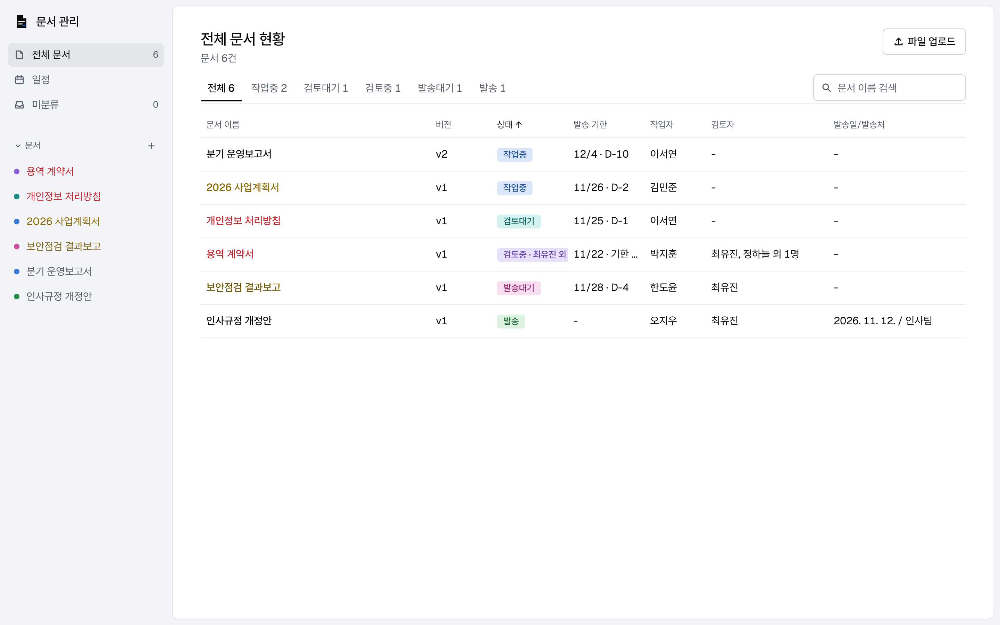
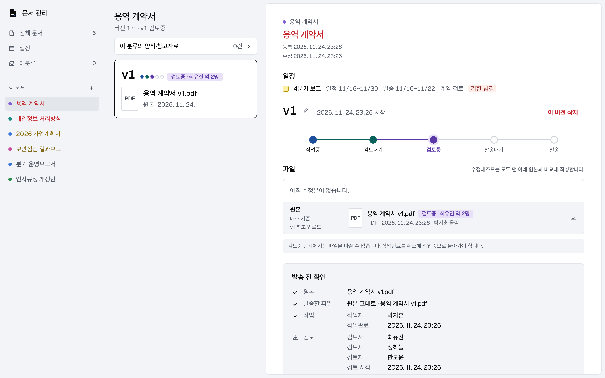
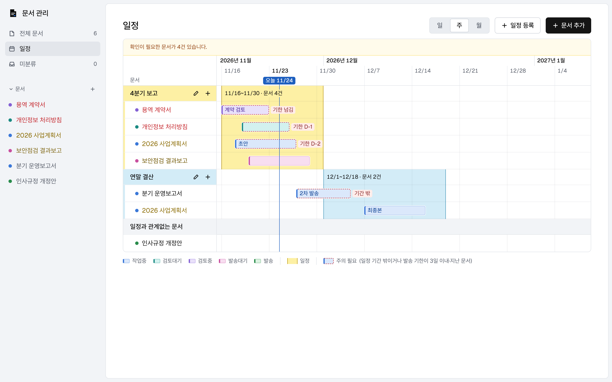
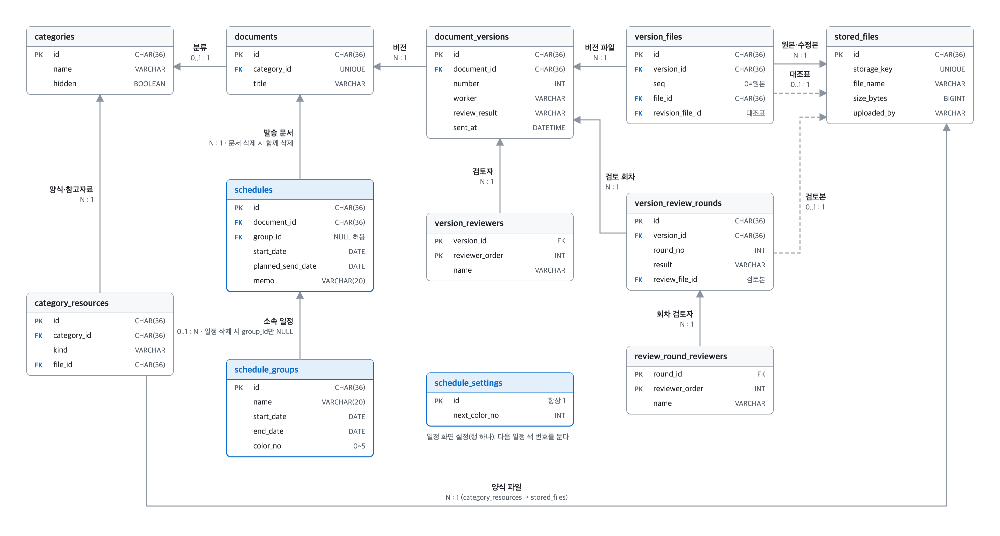

<div align="center">

# File Manager

문서의 작성, 검토, 발송 과정을 버전별로 기록하고, 발송 일정을 간트 차트로 관리하는 문서 관리 웹앱




</div>

## 소개

규정, 계약서, 보고서 같은 문서는 여러 번 고쳐서 나갑니다. 공유 폴더에 `최종.hwpx`, `최종_진짜.hwpx`, `최종_수정3.hwpx`가 쌓이면 어느 파일이 검토 중이고 어느 파일을 이미 보냈는지, 언제까지 보내야 하는지 헷갈립니다.

File Manager는 문서마다 버전을 만들고, 버전마다 원본, 수정본, 수정대조표를 묶어 둡니다. 각 버전은 아래 다섯 단계를 차례로 거치며, 누가 언제 작업하고 검토하고 발송했는지 기록됩니다. 언제까지 보낼지는 `일정` 화면의 간트 차트로 계획하고, 기한이 다가오는 문서는 화면 곳곳에서 색으로 알려 줍니다.

```
작업중 ──▶ 검토대기 ──▶ 검토중 ──▶ 발송대기 ──▶ 발송
 (작업자)    (작업완료)    (검토 시작)    (승인)       (종료)
                              │
                              └─ 거절 → 검토본과 함께 작업중으로 되돌아감
```

## 화면

<table>
  <tr>
    <td width="50%"></td>
    <td width="50%"></td>
  </tr>
  <tr>
    <td align="center">검토중인 버전. 검토자와 검토 시작 시각이 남고, 여기서 승인하거나 거절합니다. 문서가 들어 있는 일정과 발송 기한도 보입니다.</td>
    <td align="center">v2의 원본은 v1의 제출본입니다. 수정본은 수정대조표와 함께 올려야 등록됩니다.</td>
  </tr>
  <tr>
    <td colspan="2"></td>
  </tr>
  <tr>
    <td colspan="2" align="center">일정 화면. 일정마다 색칸이 깔리고, 문서별 막대는 시작일부터 발송 예정일까지입니다. 기한이 임박했거나 지났거나 일정 기간을 벗어난 문서는 붉은 점선으로 표시됩니다.</td>
  </tr>
</table>

## 주요 기능

### 문서와 버전

- 카테고리 하나에 문서가 하나 있습니다. 사이드바의 `문서` 목록에서 항목을 고르면 그 문서의 버전 목록이 열리고, 카테고리가 없는 문서는 `미분류`에 모입니다.
- 첫 버전은 파일 없이 만들 수 있습니다. 원본은 나중에 올리고, 원본을 올려야 작업완료할 수 있습니다.
- 수정본을 올릴 때는 원본과 비교한 수정대조표도 함께 올려야 합니다. 버전 문서는 `.hwpx`와 `.pdf`만 받습니다.
- 작업완료, 검토 시작, 승인, 거절, 발송은 각각 취소할 수 있습니다. 승인과 거절 결정은 회차별 이력으로 남습니다.
- 발송 전에 원본, 발송할 파일, 작업 기록, 검토 기록을 한 화면에서 확인합니다. 승인을 받지 않은 버전은 발송할 수 없습니다.
- 단계는 색으로 구분합니다(작업중 파랑, 검토대기 청록, 검토중 보라, 발송대기 분홍, 발송 초록). 작업중이면 작업자, 검토중이면 검토자 이름(여럿이면 `홍길동 외 2명`)이 함께 보입니다.
- 카테고리마다 빈 양식과 참고자료를 따로 보관할 수 있습니다.

### 일정 (간트 차트)

사이드바의 `일정`을 누르면 문서 발송 계획을 간트 차트로 봅니다.

- **일정**은 이름(20자 이하)과 시작일·종료일을 가진 기간 묶음입니다. 등록하면 배경색(노랑, 하늘, 연두, 분홍, 살구, 청록)이 차례로 자동 배정되고, 차트에 그 기간만큼의 색칸으로 그려집니다.
- **발송 문서**는 문서 하나의 시작일부터 발송 예정일까지를 나타내는 막대입니다. 일정 안에 넣거나 `일정과 관계없는 문서`로 둘 수 있고, 메모(20자 이하)를 붙일 수 있습니다. 같은 문서를 여러 번, 여러 일정에 등록할 수 있습니다.
- 시간 축은 일·주·월 단위로 바꾸고, 오늘 날짜에 세로선이 그어집니다. 막대 색은 그 문서의 현재 단계 색입니다.
- 막대를 끌어 다른 일정 칸에 놓으면 그 일정으로 옮겨집니다(날짜와 메모는 그대로). 수정 창에서 일정을 다시 고를 수도 있습니다.
- 일정 기간을 벗어났거나, 발송 기한이 3일 이내이거나 지났는데 아직 발송하지 않은 문서는 `주의 필요`로 표시됩니다. 막대에 `기간 밖`, `기한 D-2`, `기한 넘김` 같은 표시가 붙고, 차트 위에 `확인이 필요한 문서가 N건 있습니다.`라고 알립니다.
- 일정을 지워도 그 안의 발송 문서는 지워지지 않고 `일정과 관계없는 문서`로 남습니다. 그런 문서가 없으면 그 칸은 보이지 않습니다.
- 문서 상세 화면에서도 그 문서가 들어 있는 일정과 발송 예정일을 볼 수 있습니다.

### 발송 기한 알림

발송 기한은 그 문서의 발송 문서 중 가장 빠른 발송 예정일입니다(이미 발송한 문서는 기한이 없습니다).

| 남은 기간 | 문서 제목 색 |
| --- | --- |
| 8일 이상 | 원래 색 |
| 4~7일 | 점점 노랑에 가까워짐 |
| 2~3일 | 노랑 |
| 1일 이하, 기한 넘김 | 빨강 |

- 제목 색은 사이드바, 전체 문서 현황판, 문서 상세, 간트 차트에 똑같이 적용됩니다.
- 사이드바의 문서 목록은 기한이 임박한 순으로 놓이고, 현황판은 `발송 기한` 열로 정렬할 수 있습니다.

### 목록과 숨김

- 전체 문서 현황판에서 단계별 탭, 이름 검색, 열 정렬로 문서를 찾습니다.
- 보지 않을 문서는 사이드바 항목에 마우스를 올리면 나오는 버튼으로 숨깁니다. 숨긴 문서는 사이드바와 현황판의 `숨긴 문서` 칸(처음에는 접힘)으로 옮겨지고, 같은 자리에서 숨김을 해제합니다.
- 사이드바의 `문서` 목록은 접었다 펼 수 있습니다.

### 파일 저장

- 파일은 `카테고리/버전/{제목} {버전}_{yyyyMMdd}_{작업자}.pdf` 형태로 저장됩니다. 앱을 거치지 않고 SMB 공유 폴더를 직접 열어도 파일을 찾을 수 있습니다.

## 아키텍처

```
┌───────────────┐   /api    ┌────────────────────┐   JPA    ┌──────────┐
│  React + Vite │ ────────▶ │  Spring Boot 4     │ ───────▶ │ MySQL 8  │
│  (nginx :80)  │           │  (:8080, Flyway)   │          └──────────┘
└───────────────┘           │                    │  파일   ┌──────────────┐
                            │                    │ ──────▶ │ SMB 공유(CIFS)│
                            └────────────────────┘         └──────────────┘
```

| 영역 | 기술 |
| --- | --- |
| Frontend | React 19, TypeScript, Vite, oxlint. UI 라이브러리 없이 CSS만 사용(간트 차트도 직접 구현) |
| Backend | Spring Boot 4 (Web MVC, Data JPA), Flyway, Java 17 |
| Database | 운영은 MySQL 8, 개발과 테스트는 H2 MySQL 모드 |
| Storage | 로컬 디렉터리, 또는 Docker CIFS 볼륨으로 마운트한 SMB 공유 |
| Infra | Docker Compose (MySQL, backend, nginx frontend, 백업 작업) |

백엔드는 도메인마다 `presentation → application → domain ← infrastructure` 레이어로 나뉩니다. 패키지 의존 방향과 JDBC 직접 사용 금지는 `ArchitectureTest`가 검사합니다.

```
backend/src/main/java/com/fileManager
├── category/   카테고리 CRUD·숨김, 이름 변경·삭제 이벤트
├── document/   문서·버전·단계 전이(StageService)
├── file/       저장 경로 규칙, 로컬/UNC 파일 저장
├── resource/   분류별 양식·참고자료
├── schedule/   일정(간트): 발송 문서·일정·보기 설정 API
└── global/     config · error · util
```

## 실행 방법

### Docker Compose

```bash
cp .env.example .env          # SMB 사용자·비밀번호 등을 채운다
docker compose up --build
# → http://localhost:3000
```

MySQL 백업은 필요할 때 따로 실행합니다.

```bash
docker compose run --rm mysql-backup   # fileManager_<UTC>.sql.gz 를 SMB 공유에 저장
```

### 로컬 개발 (MySQL 없이)

```bash
# 1) 백엔드: H2 파일 DB를 쓰는 dev 프로필, :8080
cd backend
./gradlew bootRun --args='--spring.profiles.active=dev'

# 2) 프런트엔드: /api 요청을 :8080으로 프록시, :5173
cd frontend
npm ci
npm run dev
```

### 테스트

```bash
cd backend && ./gradlew test   # API 통합 테스트, 스키마, 아키텍처 규칙
cd frontend && npm run lint && npm run build
```

## 환경 변수

| 변수 | 기본값 | 설명 |
| --- | --- | --- |
| `FILEMANAGER_DB_USERNAME` / `_PASSWORD` | `fileManager` | DB 계정. MySQL과 백엔드가 같은 값을 씀 |
| `MYSQL_ROOT_PASSWORD` | - | MySQL root 비밀번호. 백업에도 사용 |
| `FRONTEND_PORT` | `3000` | 호스트에 노출할 포트 |
| `FILEMANAGER_SMB_HOST` / `_SHARE` | - | 파일 본문을 저장할 SMB 공유 |
| `FILEMANAGER_SMB_USERNAME` / `_PASSWORD` | 필수 | SMB 계정 |
| `FILEMANAGER_SMB_VERS` | `2.1` | SMB 프로토콜 버전 |
| `FILEMANAGER_MYSQL_BACKUP_KEEP_DAYS` | `0` | 이 일수보다 오래된 백업을 삭제. 0이면 지우지 않음 |

## 데이터 모델



- 카테고리 하나에 문서가 하나 있고(`documents.category_id` UNIQUE), 카테고리가 없는 문서는 미분류입니다.
- `stored_files`는 파일 본문의 저장 위치이고, 버전 파일·양식·검토본이 이를 가리킵니다.
- `schedules`는 발송 문서입니다. 문서가 지워지면 함께 지워지고, 일정(`schedule_groups`)이 지워지면 `group_id`만 비워집니다.
