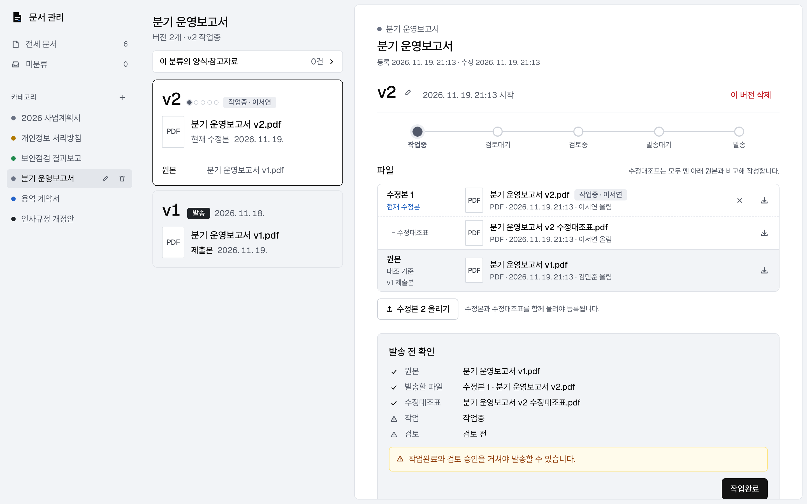

<div align="center">

# 📄 File Manager

**문서 한 건이 작성 → 검토 → 발송까지 가는 과정을 버전별로 기록하는 문서 관리 웹앱**

원본·수정본·수정대조표를 한곳에 묶고, 누가 언제 작업하고 검토하고 발송했는지 남깁니다.


</div>

---

## ✨ 왜 만들었나

규정, 계약서, 보고서 같은 문서는 한 번에 끝나지 않습니다. `최종.hwpx`, `최종_진짜.hwpx`, `최종_수정3.hwpx`가 공유 폴더에 쌓이면 지금 어느 파일이 검토 중인지, 이미 발송한 파일이 무엇인지 알기 어려워집니다.

File Manager는 문서마다 **버전**을 두고, 각 버전이 아래 5단계를 순서대로 지나가게 합니다.

```
작업중 ──▶ 검토대기 ──▶ 검토중 ──▶ 발송대기 ──▶ 발송
 (작업자)    (작업완료)    (검토 시작)    (승인)       (종료)
                              │
                              └─ 거절 → 검토본과 함께 작업중으로 되돌아감
```

## 🖼️ 화면

<table>
  <tr>
    <td width="50%"></td>
    <td width="50%"></td>
  </tr>
  <tr>
    <td align="center"><b>단계 표시와 발송 전 확인</b><br/>검토자·검토 시작 시각을 기록하고, 승인 또는 거절합니다.</td>
    <td align="center"><b>버전과 수정본 체인</b><br/>v2의 원본은 v1의 제출본입니다. 수정본은 수정대조표와 함께 올려야 등록됩니다.</td>
  </tr>
</table>

## 🚀 주요 기능

- **카테고리 하나에 문서 하나.** 사이드바에서 분류를 고르면 그 문서의 버전 목록이 바로 열립니다. 분류가 없는 문서는 `미분류`로 모입니다.
- **버전별 5단계 흐름.** 작업완료, 검토 시작, 승인, 거절, 발송의 다섯 동작은 각각 취소할 수 있고, 지나간 검토 결정은 회차별 이력으로 남습니다.
- **원본 / 수정본 / 수정대조표.** 수정본마다 원본 대비 대조표를 함께 올려야 하므로, 무엇이 바뀌었는지 항상 확인할 수 있습니다. 문서 파일은 `.hwpx`, `.pdf`만 받습니다.
- **발송 전 확인 체크리스트.** 원본, 발송할 파일, 작업, 검토 항목을 한 화면에서 확인한 뒤에만 발송할 수 있습니다.
- **전체 문서 현황판.** 단계별 탭, 검색, 정렬로 모든 문서의 진행 상황을 한눈에 봅니다.
- **분류별 양식·참고자료.** 카테고리마다 빈 양식과 작성 예시를 함께 보관합니다.
- **사람이 읽을 수 있는 저장 구조.** 파일은 `카테고리/버전/{제목} {버전}_{yyyyMMdd}_{작업자}.pdf` 형태로 저장되므로, 앱 밖에서 SMB 공유 폴더를 열어도 정리된 상태로 보입니다.

## 🏗️ 아키텍처

```
┌───────────────┐   /api    ┌────────────────────┐   JPA    ┌──────────┐
│  React + Vite │ ────────▶ │  Spring Boot 4     │ ───────▶ │ MySQL 8  │
│  (nginx :80)  │           │  (:8080, Flyway)   │          └──────────┘
└───────────────┘           │                    │  파일   ┌──────────────┐
                            │                    │ ──────▶ │ SMB 공유(CIFS)│
                            └────────────────────┘         └──────────────┘
```

| 영역 | 기술 |
| --- | --- |
| Frontend | React 19, TypeScript, Vite, oxlint, 외부 UI 라이브러리 없이 순수 CSS |
| Backend | Spring Boot 4 (Web MVC, Data JPA), Flyway, Java 17 |
| Database | MySQL 8 (운영), H2 MySQL 모드 (개발·테스트) |
| Storage | 로컬 디렉터리 또는 Docker CIFS 볼륨으로 마운트한 SMB 공유 |
| Infra | Docker Compose (MySQL · backend · nginx frontend · 백업 잡) |

백엔드는 도메인(`category`, `document`, `file`, `resource`)마다 `presentation → application → domain ← infrastructure` 레이어로 나눕니다. `ArchitectureTest`가 패키지 의존 방향과 JDBC 직접 사용 금지를 테스트로 강제합니다.

```
backend/src/main/java/com/fileManager
├── category/   카테고리 CRUD, 이름 변경·삭제 이벤트
├── document/   문서·버전·단계 전이(StageService)
├── file/       저장 경로 규칙, 로컬/UNC 파일 저장
├── resource/   분류별 양식·참고자료
└── global/     config · error · util
```

## ⚡ 빠른 시작

### Docker Compose (권장)

```bash
cp .env.example .env          # SMB 사용자·비밀번호 등을 채운다
docker compose up --build
# → http://localhost:3000
```

MySQL 백업은 필요할 때 한 번씩 실행합니다.

```bash
docker compose run --rm mysql-backup   # fileManager_<UTC>.sql.gz 를 SMB 공유에 저장
```

### 로컬 개발 (MySQL 없이)

```bash
# 1) 백엔드: H2 파일 DB를 쓰는 dev 프로필, :8080
cd backend
./gradlew bootRun --args='--spring.profiles.active=dev'

# 2) 프런트엔드: /api 요청을 :8080으로 프록시, :5173
cd frontend
npm ci
npm run dev
```

### 테스트

```bash
cd backend && ./gradlew test   # API 통합 테스트, 스키마, 아키텍처 규칙
cd frontend && npm run lint && npm run build
```

## ⚙️ 환경 변수

| 변수 | 기본값 | 설명 |
| --- | --- | --- |
| `FILEMANAGER_DB_USERNAME` / `_PASSWORD` | `fileManager` | DB 계정 (MySQL과 백엔드가 같이 씀) |
| `MYSQL_ROOT_PASSWORD` | - | MySQL root 비밀번호 (백업에도 사용) |
| `FRONTEND_PORT` | `3000` | 호스트에 노출할 포트 |
| `FILEMANAGER_SMB_HOST` / `_SHARE` | - | 파일 본문을 저장할 SMB 공유 |
| `FILEMANAGER_SMB_USERNAME` / `_PASSWORD` | **필수** | SMB 계정 |
| `FILEMANAGER_SMB_VERS` | `2.1` | SMB 프로토콜 버전 |
| `FILEMANAGER_MYSQL_BACKUP_KEEP_DAYS` | `0` | 이 일수보다 오래된 백업 삭제 (0 = 보관) |

전체 목록과 설명은 [`.env.example`](.env.example)에 있습니다.

## 🗂️ 데이터 모델

```
categories 1 ── 0..1 documents 1 ── * document_versions 1 ── * version_files ── stored_files
                                                       ├── * version_reviewers
                                                       └── * version_review_rounds ── review_round_reviewers
categories 1 ── * category_resources ── stored_files
```

DDL은 [`docs/db/schema.sql`](docs/db/schema.sql), 마이그레이션은 [`backend/src/main/resources/db/migration`](backend/src/main/resources/db/migration)에 있습니다.
